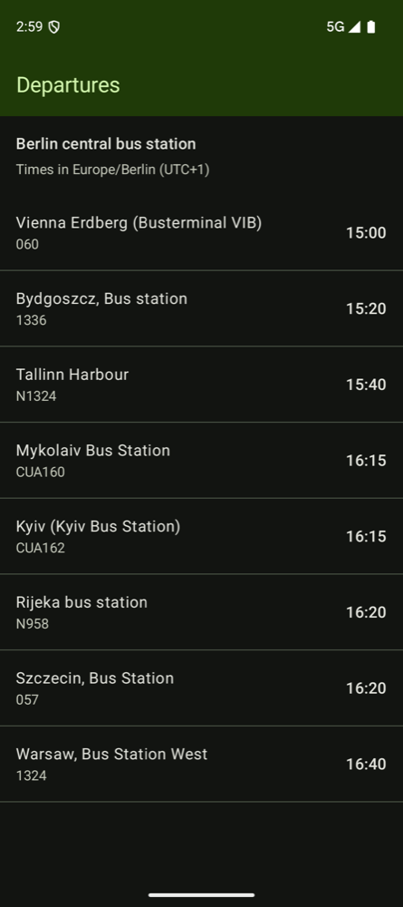
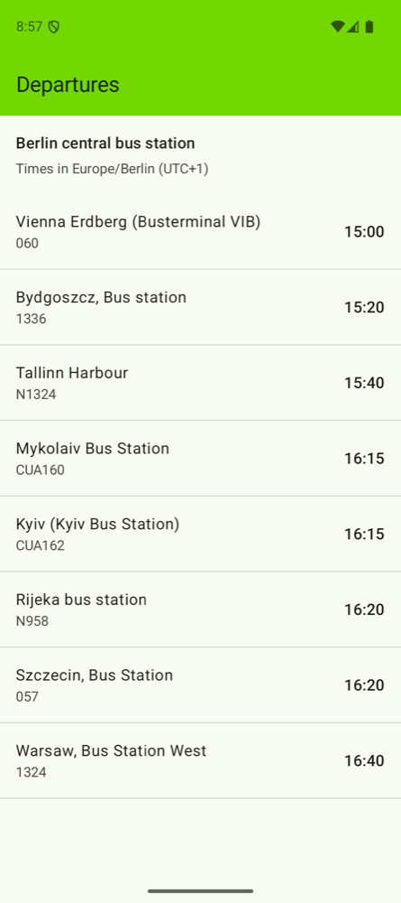
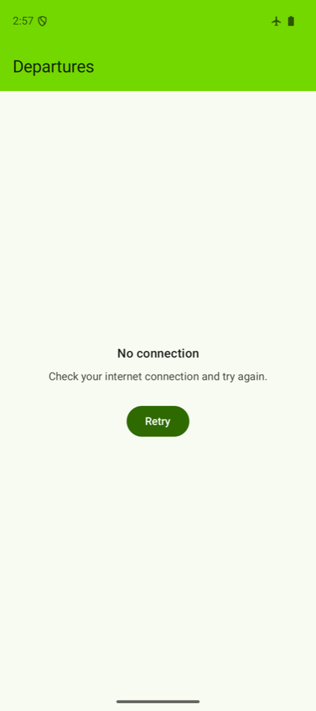
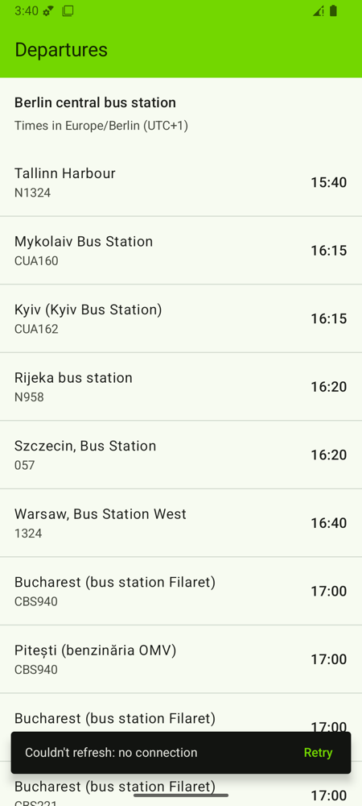
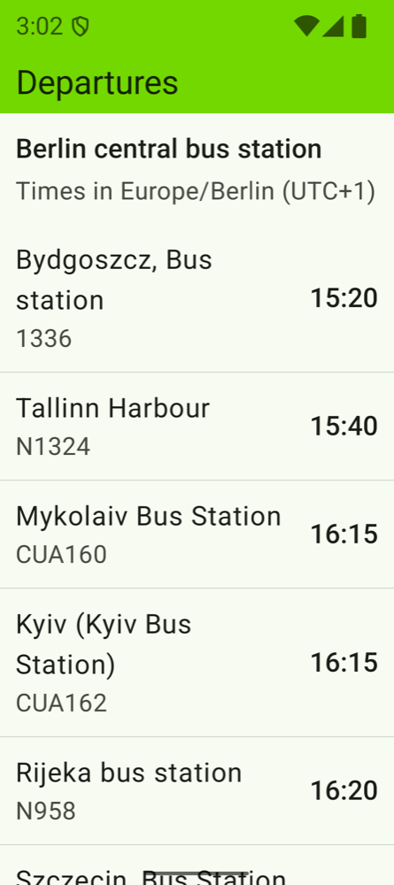

# Flix Timetable

An Android app that shows the **live departure board of Berlin central bus station** for the next two hours. Each departure shows its **line code, direction and departure time, always in the station's time zone**, even when the phone is set to another one.

Built for the Flix Android coding challenge ([brief](docs/domain/CHALLENGE.md)). The domain and data layers are **Kotlin Multiplatform** (Android + iOS targets), and the UI is Jetpack Compose.

| Departures (light) | Departures (dark) | Phone in New York, Berlin times |
|---|---|---|
|  |  |  |

| No connection | Refresh failed, list kept | Font scale 2.0 | Launcher icon |
|---|---|---|---|
|  |  |  |  |

## What it does

- **Board:** shows departures in the window `[now, now + 2h]`, sorted by time. Rides with the same id appear once.
- **Station header:** the station name and the zone the times are in, for example `Europe/Berlin (UTC+1)`.
- **Day headers:** `Today` and `Tomorrow` appear when the window crosses midnight *in the station zone*. This holds across DST changes.
- **States:** loading, empty with Refresh, and a full-screen error matched to its cause (no connection, server problem or unexpected data) with Retry.
- **Pull-to-refresh:** keeps the list visible while it loads. If it fails, the list stays and a snackbar offers Retry.
- **Robust to bad data:** one broken ride is skipped. A broken station or time zone shows an error rather than wrong times.
- **Accessible:** each row reads as *"Line N160 to Trieste, departs 16:00"*, the station header is a heading with a "Refresh departures" action for screen-reader users, and the layout holds at font scale 2.0.
- **Theme:** light and dark brand themes with checked contrast, edge-to-edge, an adaptive launcher icon with a themed (monochrome) variant.

Every behaviour is written down as a numbered rule in [`docs/domain/TIMETABLE_RULES.md`](docs/domain/TIMETABLE_RULES.md) (TT-1 … TT-17). Tests are named after the behaviour they check, for example `` `keeps API order for departures scheduled at the same time` ``.

## Run it

Requirements: JDK 17, Android SDK (compileSdk 37), and a device or emulator with API 26+. The iOS targets also need macOS with Xcode.

```bash
./gradlew :app:installDebug
adb shell am start -n com.kserocki.flix/com.kserocki.flix.app.MainActivity
```

No setup is needed: the API key is the public constant from the brief, kept in `core:data` ([why](docs/domain/API.md)).

## Test it

| What | Command |
|---|---|
| All gates (detekt + Compose rules, Konsist, Android lint, unit tests) | `./gradlew check` |
| Debug build | `./gradlew :app:assembleDebug` |
| KMP tests on the iOS simulator + iOS device compile (macOS) | `./gradlew iosSimulatorArm64Test compileKotlinIosArm64` |
| Replay a UI trail on a running emulator ([Trailblaze](https://github.com/block/trailblaze)) | `trailblaze run trails/timetable-content` |

What the tests cover:

- **Domain** (`commonTest`, runs on Android and iOS): the time window comes from an injected clock, sorting is stable, and the first copy of a duplicate ride wins. `Result` and cancellation safety are tested too.
- **Data** (`commonTest` with Ktor `MockEngine` and a fixture copied from a real API response):
  - the request format and HTTP method
  - 4xx/5xx, I/O errors and timeouts, malformed JSON
  - every ride-skipping rule, invalid time zones, cancellation
- **Presentation** (JVM): the mapper is tested with the phone in New York, station midnight versus phone midnight, and both DST transitions. The ViewModel tests cover single-flight loading, retry versus refresh, and the refresh-error effect. Compose semantics tests use Robolectric.
- **App:** `KoinGraphTest` resolves the real DI graph. The Koin compiler plugin also checks the graph at compile time.
- **End to end:** four [Trailblaze](https://github.com/block/trailblaze) trails in `trails/` replay on an emulator without an LLM. They cover content, a foreign device zone, an offline error and pull-to-refresh.

Many tests were shown to fail against a deliberately broken implementation before they were accepted.

## Architecture

Clean Architecture, multi-module, with dependencies pointing inwards:

```
app ─────────────► feature:timetable:impl ──► feature:timetable:api (NavKey)
 │                        │
 │                        ▼
 │                  core:domain  (KMP)  ◄── core:data (KMP: Ktor, kotlinx-serialization)
 │                        ▲                      │
 └──► core:designsystem   └──── core:common (KMP: Result, suspendRunCatching)
```

| Module | Contains |
|---|---|
| `app` | Composition root: Koin start (`@KoinApplication`), Nav3 `NavDisplay`, launcher icon, window theme |
| `feature:timetable:api` | `TimetableNavKey` (the public contract) |
| `feature:timetable:impl` | MVI-lite `TimetableViewModel`, UI state/intent/effect, station-zone UI mapper, Compose screen |
| `core:domain` (KMP) | `Station`, `Departure`, `StationTimetable`, `DomainError`, `DepartureRepository`, `GetStationTimetableUseCase`. Pure Kotlin, no Koin |
| `core:data` (KMP) | Ktor client (OkHttp on Android, Darwin on iOS), DTOs, `toDomain()` mapper, `NetworkDepartureRepository` |
| `core:common` (KMP) | `Result<T, E>`, `suspendRunCatching` (rethrows `CancellationException`) |
| `core:designsystem` | `FlixTheme`, colour and spacing tokens, top bar, loading and message components |
| `core:testing` (KMP) | `TestClock`, `FakeDepartureRepository`, fixtures |
| `konsist-tests` | Architecture rules, run by `./gradlew check` |
| `build-logic` | Convention plugins (`flix.*`) |

- **Data flow (UDF):** `Intent` → `ViewModel.onIntent` → use case → repository → Ktor → DTO → domain `Result` → `UiState` (StateFlow) → `TimetableContent`.
- **Errors** are values (`Result<T, DomainError>`), never exceptions across layers.
- **Details:** [`docs/ARCHITECTURE.md`](docs/ARCHITECTURE.md).

**Stack:**
- Kotlin 2.4.21, AGP 9.5.1, Gradle 9.9.1
- Compose BOM 2026.09.00 (Material 3), Navigation 3
- Koin 4.2.2 with the compiler plugin
- Ktor 3.6.1, kotlinx-serialization, kotlinx-datetime, coroutines
- Detekt 2 + Compose rules, Konsist
- Turbine, Robolectric

## Key decisions

All decisions are recorded as ADRs in [`docs/adr/`](docs/adr/README.md). The ones that shape the code most:

- **[KMP for domain and data only](docs/adr/0002-kotlin-multiplatform-for-domain-and-data.md):** the business rules are shared and checked on iOS in CI, while the UI stays idiomatic Android. A single-build monorepo was chosen over a separately published shared library.
- **[Koin with the compiler plugin, and a Koin-free domain](docs/adr/0003-koin-with-annotations-and-compiler-plugin.md):** a spike showed that annotations alone in the domain compile but fail at runtime. Use cases are therefore provided explicitly in `app`, and the plugin verifies the graph at build time.
- **[MVI-lite with UDF](docs/adr/0004-mvi-lite-with-udf.md):** one immutable state, one `onIntent`, and one-off effects for snackbars.
- **[Station time zone, never a silent fallback](docs/adr/0010-station-time-zone-for-departure-times.md):** times use the API's station zone. A missing or invalid zone is an error, because a wrong time is worse than an error. The zone label is `Europe/Berlin (UTC+1)` rather than CET/CEST, because Android's locale data would show `GMT+01:00` on a real device.
- **[Typed errors](docs/adr/0009-networking-serialization-and-typed-errors.md):** HTTP status maps to `Server`, any I/O error to `Network`, and anything else to `InvalidData`.
- **Quality gates:** [detekt + Compose rules](docs/adr/0007-detekt-with-compose-rules.md) and [Konsist](docs/adr/0005-konsist-architecture-rules.md) run with no baselines and no suppressions without a written reason. Warnings are errors in `app`.
- **[Trailblaze for agent-driven UI testing](docs/adr/0011-trailblaze-for-ui-testing.md):** manual QA leaves replayable trails behind.

## How it was built

The work was planned and tracked as GitHub issues (#1 to #5), each delivered as one PR with small commits and squash-merged. An AI agent team defined in [`AGENTS.md`](AGENTS.md) and [`.claude/`](.claude/) did the work, with a human making the product decisions:

- **Agents:** a planner, a core developer, a UI developer, a consultant, QA on the emulator and a reviewer.
- **Before code:** every issue went plan, then approval.
- **After code:** implementation, then QA with screenshots and trails, then review with up to 3 rounds, then a PR with green CI.

Product rules and decisions live in [`docs/domain/`](docs/domain/) and the ADRs.

## Docs

- [Architecture](docs/ARCHITECTURE.md) · [Decisions (ADRs)](docs/adr/README.md)
- Domain: [glossary](docs/domain/GLOSSARY.md) · [timetable rules](docs/domain/TIMETABLE_RULES.md) · [API](docs/domain/API.md) · [brief](docs/domain/CHALLENGE.md)
- [Agent guide](AGENTS.md)

## Known limitations and what's next

- **[#10](../../issues/10) Real-time delays:** the API returns `status.deviation` (late/on-time, estimated time). It isn't shown yet.
- **[#11](../../issues/11) Auto-refresh:** periodic refresh and rolling Today/Tomorrow over at midnight.
- **[#12](../../issues/12) Compose UI tests** for every screen state. Semantics are covered today.
- **[#13](../../issues/13) JDK 21:** Robolectric is pinned to SDK 35 because SDK 36+ needs Java 21.
- **[#14](../../issues/14) Landscape and tablet layouts.**
- **[#6](../../issues/6) Trails in CI** on an emulator, and **[#17](../../issues/17) iOS CI runner** resilience.
- **Fixed station:** the station is Berlin ZOB, as the brief asks. A station picker would only need a new feature module and a station id parameter.

## Third-party notices

- The launcher icon uses the **`directions_bus` glyph from [Material Symbols](https://github.com/google/material-design-icons)** by Google, licensed under the [Apache License 2.0](https://www.apache.org/licenses/LICENSE-2.0). The app is not affiliated with Flix.
- Libraries are listed in [`gradle/libs.versions.toml`](gradle/libs.versions.toml) under their own licenses.
